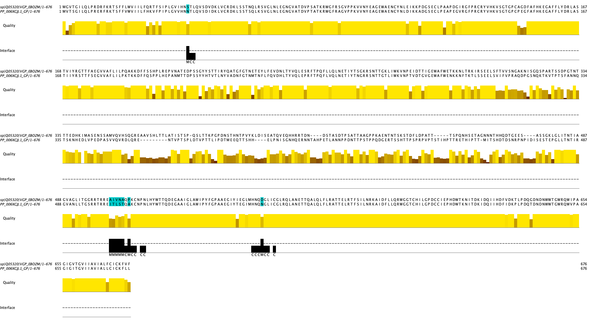
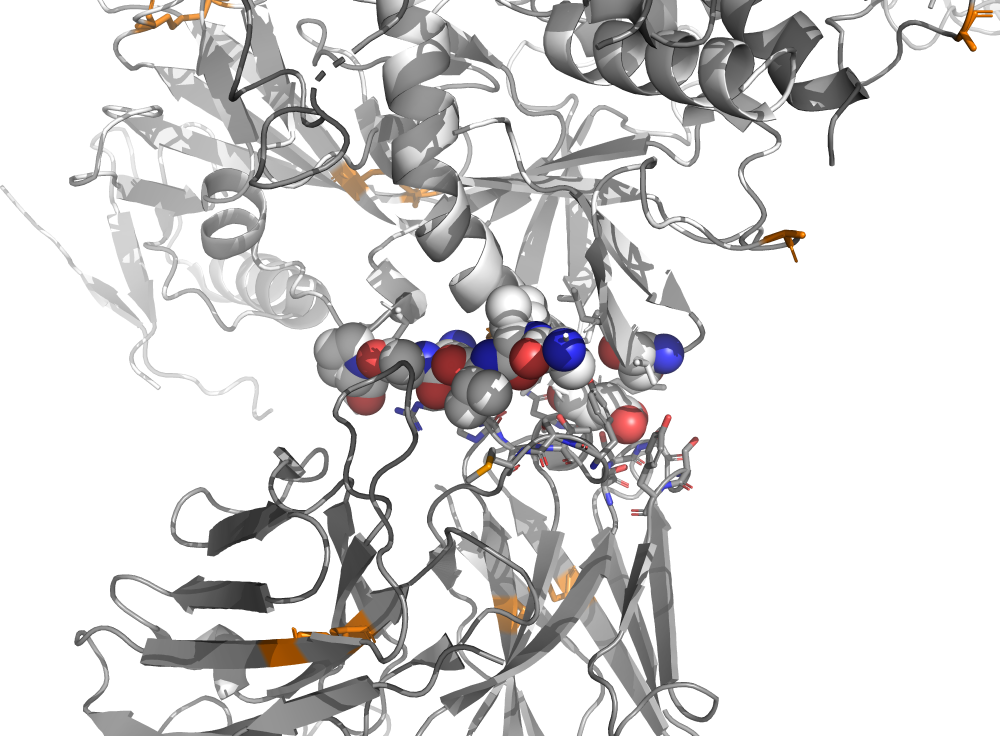

# Ebola Virus Glycoprotein Antibody Interface: Zaire vs Bundibugyo Divergence

## Overview

Comparative sequence analysis of the glycoprotein (GP) of two _Orthoebolavirus_ species, Zaire ebolavirus and Bundibugyo ebolavirus, showing where the two species differ at positions that contact an antibody in a known Zaire GP crystal structure. Zaire and Bundibugyo are distinct species (about 69% identical over aligned GP positions in this pairwise alignment), so the differences below are interspecies divergence, not within-lineage mutations or immune escape. The observations identify candidate positions for cross-reactivity studies.

## Key Findings

### Interface Sequence Divergence

- **21 antibody-contacting positions** mapped from PDB structure 3CSY (GP-antibody complex)
- **8 positions show sequence differences** between species (38% of interface positions; for comparison, about 31% of aligned GP positions differ overall, so with only 21 positions and two sequences this is not evidence that the interface diverges faster than the rest of GP)
- **13 positions are identical** between species (62% identity at interface positions)

### Sequence Differences at Interface Positions

The following positions differ between the Zaire and Bundibugyo sequences:

| Position | Zaire | Bundibugyo | Region            | Chemical Class Change                      |
| -------- | ----- | ---------- | ----------------- | ------------------------------------------ |
| 41       | Ser   | Asn        | N-terminal        | Polar → Polar (within-class)               |
| 503      | Ala   | Ile        | GP1-GP2 junction  | Small hydrophobic → Larger hydrophobic     |
| 504      | Ile   | Thr        | GP1-GP2 junction  | Hydrophobic → Polar                        |
| 505      | Val   | Leu        | GP1-GP2 junction  | Hydrophobic → Hydrophobic (different size) |
| 506      | Asn   | Ser        | GP1-GP2 junction  | Polar → Polar (within-class)               |
| 507      | Ala   | Thr        | GP1-GP2 junction  | Small → Polar                              |
| 509      | Pro   | Ala        | GP1-GP2 junction  | Cyclic → Acyclic                           |
| 552      | Asp   | Asn        | C-terminal region | Charged acidic → Polar neutral             |

_Figure: Multiple sequence alignment of Ebola virus glycoprotein sequences showing differences at antibody-contacting positions between Zaire and Bundibugyo ebolavirus._

### Structural Elements

**Disulfide Bridge Preserved**: Cysteines at positions **511** and **556** are identical in both species (C511C, C556C). This disulfide bond is conserved in this comparison, consistent with a structural constraint, though two sequences cannot establish constraint.

### Regional Clustering

The **GP1-GP2 junction region (positions 503-509)** contains the highest density of differences, at 6 of 7 positions in this cluster. Several of these substitutions involve significant chemical shifts:

- **Position 509 (Pro→Ala)**: Proline is a cyclic amino acid with unique conformational constraints; Bundibugyo has alanine here, which could change local backbone flexibility.
- **Position 552 (Asp→Asn)**: Zaire has a charged acidic residue where Bundibugyo has a polar neutral one, so a negative charge is absent from the interface, which could alter electrostatic interactions with an antibody.

**Notable outlier:**

- **Position 41 (Ser→Asn)**: Located in the N-terminal region, this difference sits in an otherwise conserved interface sector. Both residues are polar, but Bundibugyo has the larger side chain. It is an isolated difference worth checking structurally; this comparison cannot say anything about selection.

These differences warrant further structural and functional investigation.

## Next Steps for Validation

To determine whether these interspecies differences have functional consequences:

### Experimental Work Needed

- **Binding assays**: Test whether antibodies from the 3CSY structure bind both Zaire and Bundibugyo GP
- **Cross-reactivity studies**: Evaluate existing monoclonal antibodies against both species
- **Neutralization assays**: Measure whether these differences affect cross-neutralization
- **Structural modeling**: Predict how the substitutions might alter protein structure (complement, not replace, wet lab work)

### Surveillance

- Compare many sequences within each species to see which interface positions vary within a lineage, as opposed to between species
- Track whether the conserved cysteines (C511, C556) remain fixed across populations

## Methods

- Interface residues identified from PDB 3CSY crystal structure (GP-antibody complex)
- Interface defined as antibody-chain (A) and GP-chain (I, J) residues with any atom pair within 5 Å, using Biopython `NeighborSearch` (not PISA)
- Sequence alignment performed with MAFFT
- Reference: Zaire ebolavirus (UniProt Q05320)
- Comparison sequence: Bundibugyo ebolavirus (PathoPlex PP_006XCJJ.1)

## Limitations

- **Interspecies comparison**: The two sequences belong to different species, so differences reflect long-term divergence, not recent mutation or escape
- **Single structure basis**: Interface definition depends on one Zaire GP–antibody crystal structure; other antibodies may contact different positions, and contacts in Bundibugyo GP may differ
- **No functional data**: Sequence differences do not automatically imply altered binding or cross-reactivity
- **Snapshot comparison**: Two sequences only; within-species variation not assessed
- **No population data**: Cannot determine whether any difference reflects selection, neutral drift, or species-specific fixation

## Data Availability

- Alignment: `gp_aln.fasta`
- Jalview annotation: `interface_annotation.jva`
- Analysis notebook: `identify_mutations.ipynb`
- Structure: PDB 3CSY

---

_Computational analysis performed 2026-05-20 using sequence alignment and structural annotation tools. This work identifies regions for experimental validation, not functional characterization._
